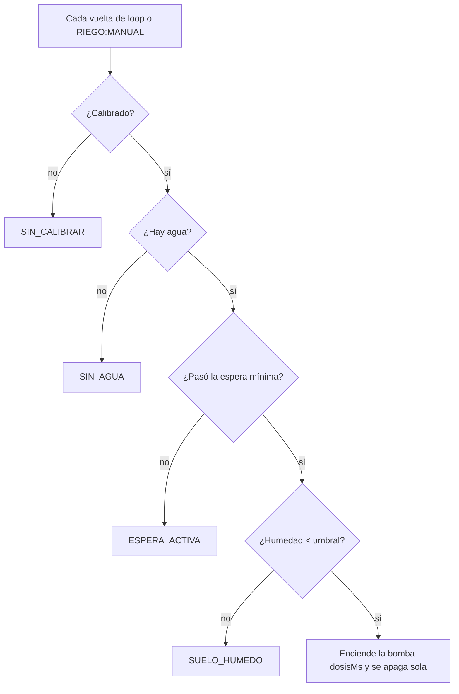

# 🌱 Smart Plant Bot

Maceta con **riego automático** sobre **Arduino Uno**. Riega solo cuando la tierra está seca, hay agua en el tanque y ya pasó el tiempo mínimo desde el último riego. También mide temperatura, humedad del aire y luz.

Proyecto Final de Ingeniería Mecatrónica · Universidad INVENIO · Guanacaste, Costa Rica · 2026

---

## 📁 Estructura del repositorio

```
smart-plant-bot/
├── firmware/
│   ├── smart_plant_bot/        ← sketch principal (abrir smart_plant_bot.ino)
│   │   ├── protocolo_serial.ino    firmware: setup(), loop(), riego y comandos
│   │   ├── plantas_lib.ino         lógica de perfiles y debeRegar()
│   │   ├── plantas.h / .cpp        14 perfiles de plantas (plantas.cpp es generado)
│   │   └── config_persistente.*    calibración y perfil en EEPROM
│   └── ejemplos/
│       ├── demo_perfiles/          imprime los perfiles por Serial
│       ├── modo_manual/            prueba de hardware: bomba con 1 / 0
│       └── violeta_africana/       sketch mínimo de un solo perfil
├── web/
│   └── plantabot.html          ← panel de control (Chrome/Edge, Web Serial)
├── herramientas/
│   ├── csv_a_header.py         regenera plantas.cpp desde el CSV
│   └── puente_serial.py        puente Serial ↔ HTTP para Firefox/Safari
├── datos/
│   └── plantas.csv             perfiles de plantas con fuentes
└── docs/
    ├── MANUAL.md               manual técnico completo del firmware
    └── entrega-final/          informe (.docx) y presentaciones (.pptx)
```

## 🔧 Hardware

| Componente | Modelo | Función |
|---|---|---|
| Microcontrolador | Arduino Uno (ATmega328P) | Decide cuándo regar |
| Humedad de suelo | Capacitivo AD69070 | Qué tan seca está la tierra |
| Nivel de agua | Flotador AD12343 | Si queda agua en el tanque |
| Ambiente | DHT22 + BH1750 | Temperatura, humedad del aire y luz |
| Bomba | Diafragma DC 12 V | Lleva el agua a la maceta |
| Potencia | MOSFET FQP30N06 + diodo 1N4007 | Enciende la bomba con protección |
| Alimentación | Fuente 12 V / 8 A + LM2596 | 12 V bomba · 5 V control |

## 🔌 Conexiones

| Elemento | Pin Arduino |
|---|---|
| Sensor de humedad | `A0` |
| DHT22 (datos) | `D2` |
| Flotador | `D3` (pull-up interno, HIGH = hay agua) |
| Puerta del MOSFET (bomba) | `D7` |
| BH1750 SDA / SCL | `A4` / `A5` |

> ⚠️ Estos son los pines del firmware. El informe de `docs/entrega-final/` usa otros pines en su tabla de terminales y debe corregirse.

## 🧠 Lógica de riego



| Categoría | Riega bajo | Bomba | Espera mínima |
|---|---|---|---|
| Suculenta | 15 % | 2 s | 168 h |
| Mediterránea | 28 % | 4 s | 48 h |
| Tropical | 45 % | 5 s | 24 h |
| Hortaliza | 55 % | 6 s | 12 h |

## 🚀 Inicio rápido

1. Instalar en el Arduino IDE las librerías **DHT sensor library** (Adafruit) y **BH1750** (Christopher Laws).
2. Abrir `firmware/smart_plant_bot/smart_plant_bot.ino` y subirlo al Arduino Uno.
3. Abrir el Monitor Serie a **9600 baudios** con fin de línea "Nueva línea". Debe aparecer `OK;INICIO`.
4. Elegir la planta: `LISTAR` y después `SELECT;<n>`.
5. Calibrar: `CAL;SECO` con el sensor al aire y `CAL;AGUA` con el sensor en agua.
6. Verificar con `ESTADO`. Desde ahí riega solo.

Para usar el panel web, abrir `web/plantabot.html` en Chrome o Edge (cerrar antes el Monitor Serie).

## 💬 Comandos por Serial

| Comando | Qué hace |
|---|---|
| `LISTAR` | Lista los 14 perfiles |
| `SELECT;n` | Elige la planta n y la guarda en EEPROM |
| `CAL;SECO` / `CAL;AGUA` / `CAL;RESET` | Calibración del sensor de humedad |
| `ESTADO` | Lecturas y motivo por el que no riega |
| `RIEGO;MANUAL` | Riega una dosis si se cumplen las condiciones |
| `AYUDA` | Lista los comandos |

## 📚 Documentación

- [Manual técnico del firmware](docs/MANUAL.md): perfiles, calibración, EEPROM, protocolo y memoria.
- [Entrega final](docs/entrega-final/): informe y presentaciones.

## 👥 Equipo

Héctor José Caldera Alfaro · Kensy Jimena Castro Vásquez · José Mario Molina Herrera · María Fernanda Porras Ruiz
